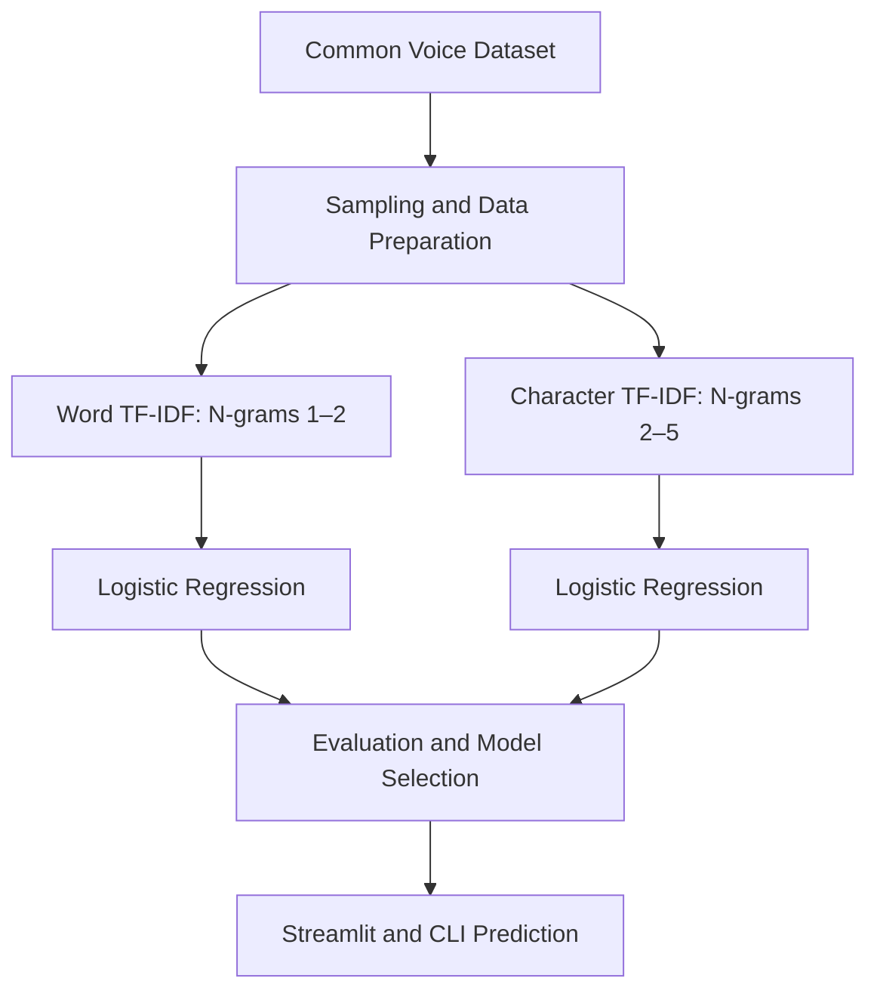

# LinguaLens

**Multilingual Short-Text Language Detection**


## Project Overview

LinguaLens is a multilingual natural language processing application designed to identify the language of short text inputs using machine learning. The project compares word-level and character-level TF-IDF representations combined with Logistic Regression, with particular attention to short-text classification and error analysis.

## Supported Languages

| Language | Code |
|---|---|
| Turkish | TR |
| English | EN |
| German | DE |
| French | FR |

## Key Features

- Multilingual text classification.
- Memory-efficient reservoir sampling.
- Short-text-focused training dataset.
- Unicode normalization and duplicate detection.
- Word and character n-gram comparison.
- Length-based performance evaluation.
- Comparative error analysis.
- Interactive Streamlit interface and CLI prediction.

## Dataset

Mozilla Common Voice Text Language Identification Dataset.

| Split | Samples | Share |
|---|---:|---:|
| Training | 32,000 | 80% |
| Validation | 4,000 | 10% |
| Test | 4,000 | 10% |
| Total | 40,000 | 100% |

Samples per language: 10,000.

[Original dataset source](https://mozilladatacollective.com/datasets/cmj8ddapc02c8mb07l6wyr882)

## Short-Text Dataset Engineering

| Text length | Training samples per language |
|---|---:|
| 1–3 words | 2,000 |
| 4–7 words | 3,000 |
| 8–15 words | 3,000 |

The training dataset is balanced across four languages. Normalized duplicate texts and overlaps with the validation and test sets are excluded during short-focused training data preparation.

## Machine Learning Architecture



## Model Configuration

| Parameter | Word model | Character model |
|---|---|---|
| Analyzer | word | char_wb |
| N-gram range | 1–2 | 2–5 |
| Max features | 30,000 | 50,000 |
| Min document frequency | 2 | 2 |
| Classifier | Logistic Regression | Logistic Regression |
| Max iterations | 300 | 300 |

## Model Performance

| Model | Reported Test Macro F1 |
|---|---:|
| Word N-gram + Logistic Regression | 0.9965 |
| Character N-gram + Logistic Regression | **0.9983** |

The character model achieved a reported Macro F1 of **0.8793** on the subset of test texts containing 1–3 words.

Character-level features achieved the highest reported overall test performance. However, very short texts remain more challenging because of limited linguistic context.

## Example Predictions

| Example input | Expected language |
|---|---|
| Bugün hava çok güzel. | Turkish |
| How are you today? | English |
| Guten Morgen! | German |
| Bonjour, comment allez-vous? | French |

Illustrative inputs, not independently executed predictions.

## Repository Structure

```text
lingualens/
├── notebooks/
│   └── 01_data_exploration.ipynb
├── src/
│   ├── data_exploration.py
│   ├── prepare_dataset.py
│   ├── prepare_short_dataset.py
│   ├── train_baseline.py
│   ├── predict.py
│   └── web_app.py
├── main.py
├── requirements.txt
├── .gitignore
└── README.md
```

## Installation & Usage

```bash
git clone https://github.com/blgmstf332/lingualens.git
cd lingualens
pip install -r requirements.txt
```

Download and extract the dataset to:

`data/raw/mcv_text_lid/mcv_text_lid.tsv`

Prepare the dataset and train the models:

```bash
python src/prepare_dataset.py
python src/prepare_short_dataset.py
python src/train_baseline.py
```

Launch the web application:

```bash
streamlit run src/web_app.py
```

Alternatively, use the command-line interface:

```bash
python src/predict.py
```

The dataset and trained model are not tracked in Git. The training script generates the character model as a Joblib artifact.

## Limitations & Future Improvements

- Extend support to additional languages.
- Introduce unknown-language detection.
- Improve classification of ambiguous and extremely short texts.
- Evaluate multilingual and code-switched inputs.
- Validate generalization on independent real-world datasets.
- Compare classical models with transformer-based approaches.

## Author

**Mustafa Kılıç**

Computer Engineering Student — Artificial Intelligence, Machine Learning & Data Science

[GitHub](https://github.com/blgmstf332)
